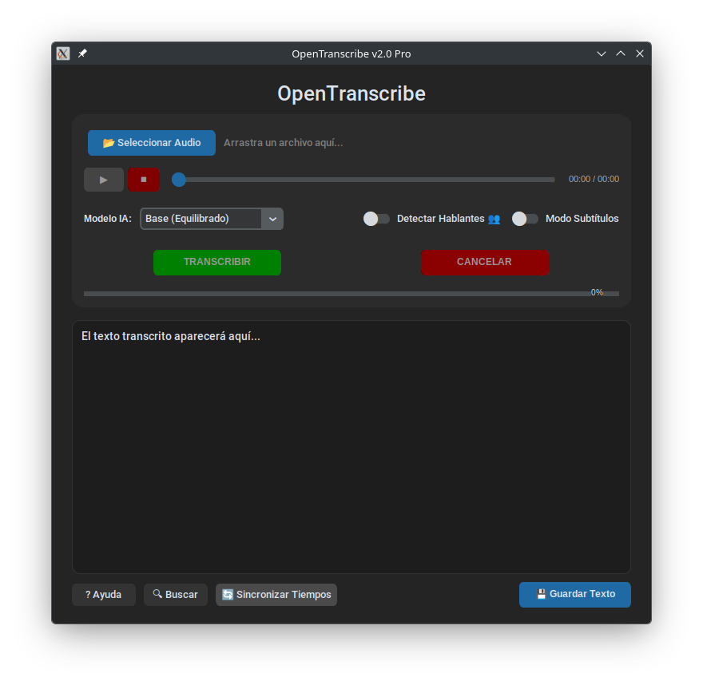

🌐 **English** · [Español](README.es.md) · [Euskara](README.eus.md)

# OpenTranscribe 🎙️

<p align="center">
  
</p>

<p align="center">
  <strong>Transcribe audio and video to text on your own computer, offline and without sending anything to the cloud, powered by Whisper (C++).</strong>
</p>

<p align="center">
  
  
  
  
  
</p>

<p align="center">
  
</p>

---

## 🚀 Features

- **100% local:** your audio never leaves your computer. The internet is only used to download the models the first time and to check for a new version at startup (this can be turned off in Help).
- **Update notices:** when a new version is released, the app tells you and links to the download.
- **Audio and video:** MP3, WAV, M4A, MP4, MKV, MOV, AVI, WEBM and FLV. No need to extract the audio first.
- **Several models:** from *Tiny* (very fast) to *Large* (maximum accuracy). They are downloaded automatically when needed.
- **Export to multiple formats:** Word (.docx), CSV, SRT, VTT and TXT.
- **Queue mode:** drag several files at once and they are transcribed and saved one after another automatically.
- **Speakers by channel:** in stereo recordings with each person on a separate channel (calls, podcasts), it identifies who is speaking (left = Speaker 1, right = Speaker 2).
- **Karaoke editor:** built-in player that highlights the text as you listen.
- **Find and replace** to correct the transcription before saving it.
- **Dark interface** built with CustomTkinter, with drag and drop for files.

> The interface is currently in Spanish; button names below are quoted as they appear in the app, followed by their English meaning.

---

## 🛠️ Requirements

- **Linux x86-64** with an AVX2-capable processor (practically any from 2013-2015 onwards).
- **FFmpeg** installed on the system:
  - Debian/Ubuntu: `sudo apt install ffmpeg`
  - Fedora: `sudo dnf install ffmpeg` (from RPM Fusion)
  - openSUSE: `sudo zypper install ffmpeg` (the one in the official repositories is enough)
- To run from source: **Python 3.10+**, `git`, `cmake` and `g++`.

---

## 📦 Installation

### From prebuilt packages

Download the package from [Releases](https://github.com/AnabasaSoft/OpenTranscribe/releases):

- **Debian/Ubuntu (.deb):**
  ```bash
  sudo apt install ./OpenTranscribe-linux-x64.deb
  ```

- **Fedora (.rpm):**
  ```bash
  sudo dnf install ./OpenTranscribe-linux-x64.rpm
  ```

- **openSUSE Tumbleweed / Leap (.rpm):**
  ```bash
  sudo zypper install ./OpenTranscribe-linux-x64.rpm
  ```
  The FFmpeg from the official repositories is enough: OpenTranscribe only needs to read the audio, and that FFmpeg decodes AAC, MP3, Opus, Vorbis and FLAC, including inside MP4 or MKV videos. Packman is not needed.

- **AppImage (any distribution, no installation):**
  ```bash
  chmod +x OpenTranscribe-x86_64.AppImage
  ./OpenTranscribe-x86_64.AppImage
  ```
  A single file that works on any distribution. It only needs **FFmpeg** to be installed.
  If your system does not have FUSE (uncommon on desktops), run it with `./OpenTranscribe-x86_64.AppImage --appimage-extract-and-run`.

- **Compressed folder (no installation):**
  ```bash
  tar xzf OpenTranscribe-linux-x64.tar.gz
  ./OpenTranscribe/OpenTranscribe
  ```

The packages work on distributions with glibc 2.35 or later (Ubuntu 22.04, Debian 12, Fedora 36, openSUSE Leap 15.6 or newer).

### From source

1. Clone the repository:
   ```bash
   git clone https://github.com/AnabasaSoft/OpenTranscribe.git
   cd OpenTranscribe
   ```

2. Install the dependencies:
   ```bash
   pip install -r requirements.txt
   ```

3. Build the transcription engine:
   ```bash
   ./build_whisper.sh
   ```
   This generates `binaries_linux/whisper-cli` from whisper.cpp.

---

## ▶️ Usage

```bash
python main.py
```

1. Drag an audio or video file onto the window (or click **📂 Seleccionar Audio** — Select audio).
2. Choose the **AI model**. *Base* is a good balance between speed and accuracy.
3. Turn on **Modo Subtítulos** (Subtitle mode) if you want timestamps (needed for SRT/VTT and for karaoke).
4. Click **TRANSCRIBIR** (Transcribe) and, when it finishes, **💾 Guardar Texto** (Save text).

If you drag **several files**, queue mode is activated: you choose the format and destination folder once, and each transcription is saved automatically.

Models are stored in `~/.OpenTranscribe/models/`.

---

## 📄 License

This project is licensed under the **GNU General Public License v3.0 (GPL-3.0)**.
See the `LICENSE` file for the full text.

Copyright (C) 2025-2026 AnabasaSoft

### What it means in practice

- ✅ You can **use** OpenTranscribe freely, including in your company and for commercial purposes
- ✅ You can **study, modify and redistribute** the code
- ⚠️ If you distribute a modified version, you must release it **under GPL-3.0 as well** and provide its source code
- ⚠️ You must keep the copyright and license notices

### License notice

```
OpenTranscribe - Local audio and video transcription
Copyright (C) 2025-2026 AnabasaSoft

This program is free software: you can redistribute it and/or modify
it under the terms of the GNU General Public License as published by
the Free Software Foundation, either version 3 of the License, or
(at your option) any later version.

This program is distributed in the hope that it will be useful,
but WITHOUT ANY WARRANTY; without even the implied warranty of
MERCHANTABILITY or FITNESS FOR A PARTICULAR PURPOSE.  See the
GNU General Public License for more details.

You should have received a copy of the GNU General Public License
along with this program.  If not, see <https://www.gnu.org/licenses/>.
```

> **Note on commercial licenses**: AnabasaSoft is the sole copyright holder
> of OpenTranscribe and can therefore offer the same code under terms other
> than the GPL. If you need to integrate OpenTranscribe into a proprietary
> product, get in touch.

---

## 📧 Contact

**AnabasaSoft**

- 📧 Email: [anabasasoft@gmail.com](mailto:anabasasoft@gmail.com)
- 🌐 GitHub: [github.com/AnabasaSoft](https://github.com/AnabasaSoft)
- 💼 Project: [github.com/AnabasaSoft/OpenTranscribe](https://github.com/AnabasaSoft/OpenTranscribe)

---

## 🙏 Acknowledgements

- [whisper.cpp](https://github.com/ggml-org/whisper.cpp): C/C++ transcription engine based on OpenAI's Whisper
- [FFmpeg](https://ffmpeg.org/): audio and video conversion and decoding
- [CustomTkinter](https://github.com/TomSchimansky/CustomTkinter): modern graphical interface on top of Tkinter
- [tkinterdnd2](https://github.com/Eliav2/tkinterdnd2): file drag and drop
- [pygame](https://www.pygame.org/): audio playback for karaoke mode
- [python-docx](https://github.com/python-openxml/python-docx): Word export
- [Pillow](https://python-pillow.org/): image processing
- The open source community, for its support and contributions

---

<div align="center">


**Made with ❤️ by [Anabasa Software](https://anabasasoft.github.io)**

📧 Email: [anabasasoft@gmail.com](mailto:anabasasoft@gmail.com) • 🌐 Portfolio: [anabasasoft.github.io](https://anabasasoft.github.io)

⭐ If you like this project, give it a star on GitHub

</div>

<div align="center">
  <br/>
  <p><code>>_ sudo buy-me-a-coffee --theme=dark --force</code></p>
  <a href="https://www.buymeacoffee.com/danitxu" target="_blank">
    
  </a>
  <br/>
</div>
